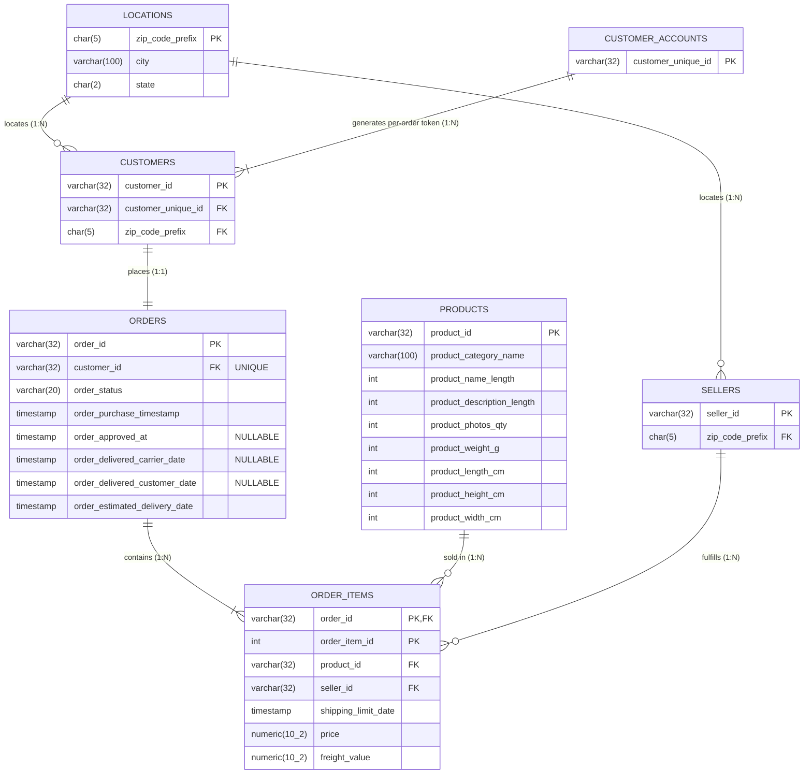

# Olist Commerce Analytics Pipeline (EAS 550)

An end-to-end, reproducible relational data warehouse and analytics pipeline built on the **Olist Brazilian E-Commerce Public Dataset** (CC BY-NC-SA 4.0).

This repository implements **Phase 1: Relational Modeling & Idempotent Ingestion**, establishing a normalized 3NF PostgreSQL foundation, deterministic dataset subsetting, transactional `ON CONFLICT` upserts via `uv`, and automated verification checks.

## 1. Repository Structure

```text
olist-commerce-analytics/
├── .env.example              # Environment variable template (credentials excluded from Git)
├── .gitignore                # Excludes .env, .venv, and raw CSV data files
├── .python-version           # Pinned Python 3.11 runtime
├── docker-compose.yml        # PostgreSQL 16 service with automatic DDL initialization
├── pyproject.toml            # Project metadata and dependencies managed by uv
├── uv.lock                   # Locked dependency graph for reproducible builds
├── README.md                 # Setup runbook, ERD, 3NF Design Note, and verification log
├── run1_evidence.json        # Verification fingerprint captured after initial load (Run #1)
├── run2_evidence.json        # Verification fingerprint captured after idempotent rerun (Run #2)
├── sql/
│   ├── schema.sql            # PostgreSQL DDL (tables, PK/FK, UNIQUE, CHECK, indexes)
│   └── verify.sql            # Standalone SQL row-count, integrity, and quality checks
└── src/
    ├── ingest.py             # Deterministic subsetting, validation, & idempotent upsert
    └── verify.py             # Automated verification & rerun fingerprint reporter
```

## 2. Setup & Execution Runbook (`uv` + Docker)

### Prerequisites

* **Docker & Docker Compose** (or local **PostgreSQL 14+**)
* **Python 3.11+** and [**`uv`**](https://docs.astral.sh/uv/)
* Raw Olist CSV files downloaded from the course archive or Kaggle (*Brazilian E-Commerce Public Dataset by Olist*, CC BY-NC-SA 4.0) and placed in `./data/raw/`:
  * `olist_orders_dataset.csv`
  * `olist_customers_dataset.csv`
  * `olist_order_items_dataset.csv`
  * `olist_products_dataset.csv`
  * `olist_sellers_dataset.csv`

### Step-by-Step Commands

```bash
# 1. Install locked Python environment via uv
uv sync

# 2. Configure local database credentials
cp .env.example .env
# Edit .env with your local PostgreSQL host, port, database name, user, and password

# 3. Start an empty PostgreSQL 16 container (automatically executes sql/schema.sql on init)
docker compose up -d

# (Alternative if using a local non-Docker PostgreSQL server instead of step 3):
# createdb -U postgres olist_db
# psql -U postgres -d olist_db -f sql/schema.sql

# 4. Run initial ingestion (Run #1) and capture verification baseline
uv run python src/ingest.py
uv run python src/verify.py > run1_evidence.json

# 5. Re-run ingestion (Run #2) to prove idempotency and verify identical database state
uv run python src/ingest.py
uv run python src/verify.py > run2_evidence.json

# 6. Confirm zero logical data change across reruns (must return empty diff)
diff -u run1_evidence.json run2_evidence.json

# 7. (Optional) Execute standalone SQL verification suite
docker compose exec -T postgres psql -U postgres -d olist_db -f /docker-entrypoint-initdb.d/01_schema.sql
psql -h localhost -U postgres -d olist_db -f sql/verify.sql
```

## 3. Entity-Relationship Diagram (ERD)



## 4. Relational Design Note

### 4.1 Domain Entities & Many-to-Many Resolution

The core analytical grain of the Olist retail domain is the **order line item** (`order_items`), uniquely identified by the composite primary key `(order_id, order_item_id)`. In business operations, a single customer order can include multiple products fulfilled by multiple independent merchants (`sellers`), creating a ternary many-to-many relationship among `orders`, `products`, and `sellers`.

Rather than denormalizing order headers onto individual line items—which would repeat order-level timestamps and status values across multi-item orders and distort order-level aggregations—this schema decomposes the operational domain into seven normalized relations:

1. **`locations`**: Canonical Brazilian 5-digit postal prefixes (`zip_code_prefix`) mapped to city and 2-letter state codes.
2. **`customer_accounts`**: Persistent human buyer identities (`customer_unique_id`) enabling repeat-purchase analysis.
3. **`customers`**: Order-specific customer tokens (`customer_id`) linking each order to a `customer_unique_id` and `zip_code_prefix`.
4. **`sellers`**: Merchants fulfilling line items, linked to `locations`.
5. **`products`**: Catalog items with category labels and physical package attributes.
6. **`orders`**: Order header records (`1:1` with `customers` via `UNIQUE` foreign key on `customer_id`).
7. **`order_items`**: Associative fact-level line items resolving the many-to-many relationships between `orders`, `products`, and `sellers`.

### 4.2 Functional Dependencies (FDs)

* **`locations`**:
  `zip_code_prefix` → `{city, state}`

* **`customer_accounts`**:
  `customer_unique_id` → `∅` *(entity key)*

* **`customers`**:
  `customer_id` → `{customer_unique_id, zip_code_prefix}`

* **`sellers`**:
  `seller_id` → `zip_code_prefix`

* **`products`**:
  `product_id` → `{product_category_name, product_name_length, product_description_length, product_photos_qty, product_weight_g, product_length_cm, product_height_cm, product_width_cm}`

* **`orders`**:
  `order_id` → `{customer_id, order_status, order_purchase_timestamp, order_approved_at, order_delivered_carrier_date, order_delivered_customer_date, order_estimated_delivery_date}`
  *(Note: `customer_id` is also a candidate key due to Olist's per-order token design, enforced via `UNIQUE`.)*

* **`order_items`**:
  `{order_id, order_item_id}` → `{product_id, seller_id, shipping_limit_date, price, freight_value}`

### 4.3 Proof of Third Normal Form (3NF)

1. **First Normal Form (1NF)**: Every attribute across all seven tables holds an atomic scalar value, repeating item groups are separated into `order_items`, and every table defines an explicit primary key.
2. **Second Normal Form (2NF)**: Six of the seven tables have single-column primary keys and are automatically in 2NF. The sole composite-key table is `order_items(order_id, order_item_id)`. Every non-prime attribute in `order_items` (`product_id`, `seller_id`, `shipping_limit_date`, `price`, `freight_value`) depends on the **entire** composite key: a single `order_id` can contain distinct products, different sellers, and varying item prices/freight charges, while `order_item_id` (`1, 2, 3...`) has no meaning without `order_id`. Thus, no partial dependencies exist.
3. **Third Normal Form (3NF)**: In the raw Olist CSVs, storing `customer_zip_code_prefix`, `customer_city`, and `customer_state` together inside `customers` (and similarly inside `sellers`) creates a **transitive functional dependency**:
   `customer_id` → `zip_code_prefix` → `{city, state}`
   Decomposing `locations` removes this transitive dependency, eliminating update anomalies and inconsistent city spellings across shared postal prefixes. All remaining non-prime attributes depend directly and non-transitively on their table's candidate key(s).

### 4.4 Valid Domain Exceptions & Constraint Design

Instead of imposing overly strict DDL rules that would reject legitimate operational records, constraints reflect actual e-commerce behavior:

* **Nullable Post-Purchase Timestamps (`orders`)**: `order_approved_at`, `order_delivered_carrier_date`, and `order_delivered_customer_date` permit `NULL` because orders in `created`, `canceled`, `unavailable`, or `invoiced` states have not reached downstream fulfillment stages.
* **Timestamp Sequence Tolerance**: We intentionally omit a rigid DDL `CHECK (order_delivered_customer_date >= order_purchase_timestamp)` constraint because minor carrier clock skew occurs in historical Olist logistics logs. Rather than failing ingestion, `src/verify.py` counts and surfaces these rows under `temporal_anomalies` for downstream analytical handling.
* **Non-Negative Financial Measures (`price >= 0`, `freight_value >= 0`)**: Promotional items and free-shipping campaigns legitimately carry `0.00` values, so `>= 0` is enforced rather than `> 0`.
* **Missing Product Metadata**: Roughly 1.5% of Olist catalog items omit category labels or package dimensions. During ingestion, missing `product_category_name` values are imputed as `'uncategorized'` (`NOT NULL`), while physical dimensions allow `NULL` (with `>= 0` checks when non-null) so valid sales transactions are preserved.

## 5. Subsetting, Data Hygiene & Idempotency Strategy

* **Deterministic Subset Selection**: Raw orders are validated for non-null keys and timestamps, sorted deterministically by `(order_purchase_timestamp ASC, order_id ASC)`, and sliced to the first `SUBSET_ORDER_LIMIT=10000` orders. Dependent `order_items` and referenced parent records (`customers`, `customer_accounts`, `products`, `sellers`, `locations`) are filtered to match this exact set, guaranteeing zero orphaned foreign keys.
* **Data Cleaning & Logging**:
  * Zip codes are stripped and zero-padded to 5 digits (`zfill(5)`); city names are normalized to lowercase and state codes to uppercase.
  * Physically impossible negative product dimensions/weights are coerced to `NULL` prior to load.
  * Every rejected or imputed record count is logged to stdout during `src/ingest.py`.
* **Safe Repeat Execution**: `src/ingest.py` loads tables in strict topological parent-to-child order inside a single SQLAlchemy transaction (`with engine.begin() as conn:`) using PostgreSQL `INSERT ... ON CONFLICT (pk) DO UPDATE`. Re-running ingestion on unchanged CSV inputs leaves row counts, primary keys, and financial checksums (`SUM(price)`, `SUM(freight_value)`) completely unchanged.

## 6. Verification & Rerun Evidence

Both `run1_evidence.json` and `run2_evidence.json` are committed at the repository root and confirm exact determinism across repeated runs on the 10,000-order subset.

### 6.1 Loaded Table Counts & Quality Summary

| Table / Check | Count / Value | Notes |
| :--- | :---: | :--- |
| `locations` | **6,178** | Deduplicated 5-digit postal prefixes across subset customers & sellers |
| `customer_accounts` | **9,782** | Distinct `customer_unique_id` buyers across 10,000 orders |
| `customers` | **10,000** | Order-level customer tokens (`1:1` with `orders`) |
| `sellers` | **890** | Distinct merchants fulfilling items in the 10,000-order subset |
| `products` | **5,253** | Distinct products sold in the subset (missing categories imputed as `'uncategorized'`) |
| `orders` | **10,000** | Earliest 10,000 valid orders sorted by `(order_purchase_timestamp, order_id)` |
| `order_items` | **11,192** | Line items matching the 10,000-order subset (`0` invalid/duplicate rows) |
| Duplicate PK Violations | **0** | Checked on `orders` and `order_items` |
| Orphaned FK Violations | **0** | Checked across all parent-child relationships |
| Negative Price / Freight | **0** | All line-item measures satisfy `>= 0` |
| Temporal Anomalies | **0** | Zero delivered orders preceding `order_purchase_timestamp` |

### 6.2 Verification Fingerprint (`run1_evidence.json` & `run2_evidence.json`)

```json
{
  "row_counts": {
    "locations": 6178,
    "customer_accounts": 9782,
    "customers": 10000,
    "sellers": 890,
    "products": 5253,
    "orders": 10000,
    "order_items": 11192
  },
  "duplicate_violations": {
    "orders": 0,
    "order_items": 0
  },
  "orphan_violations": {
    "orders_to_customers": 0,
    "items_to_orders": 0,
    "items_to_products": 0,
    "items_to_sellers": 0
  },
  "measure_fingerprint": {
    "item_rows": 11192,
    "sum_price": "1420857.13",
    "sum_freight": "216858.65",
    "negative_amounts": 0
  },
  "temporal_anomalies": 0
}
```

### 6.3 Idempotency Diff Check

```bash
$ diff -u run1_evidence.json run2_evidence.json
# Exit code 0 (empty output — zero changes in row counts, keys, or financial aggregates)
```